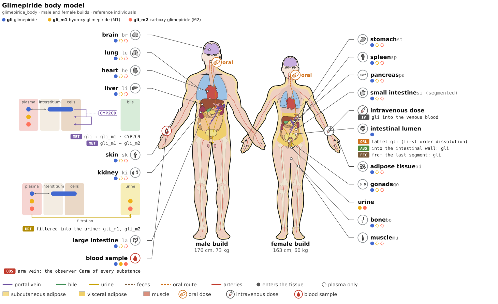

# pkpdsim: PBPK/PD models in SBML using python
[](https://github.com/matthiaskoenig/pkpdsim/actions/workflows/ci-cd.yml)
[](https://matthiaskoenig.github.io/pkpdsim)
[](https://pypi.org/project/pkpdsim/)
[](https://pypi.org/project/pkpdsim/)
[](https://opensource.org/licenses/MIT)
[](https://doi.org/10.5281/zenodo.23297325)

`pkpdsim` is a library for physiologically based pharmacokinetic and pharmacodynamic (PBPK/PD) models in [SBML](https://sbml.org): a standard physiology at its centre, the substances, chemistry, routes and observers of a model on top of it, and the simulation experiments, fits, scans, uncertainty and credibility of [sbmlsim](https://github.com/matthiaskoenig/sbmlsim) on top of those. A model package writes one definition of what is specific to its substances; the library adds the body and writes the SBML with the factory of [sbmlutils](https://github.com/matthiaskoenig/sbmlutils), a comp model with one submodel per organ and the flat model which is simulated. The models of [pkdb_models](https://github.com/matthiaskoenig/pkdb_models) are being rebuilt from it, each in a repository of its own.

[](https://matthiaskoenig.github.io/pkpdsim/pbpk/figures/)

*The anatomical figure of the glimepiride-like model of the [tutorial](https://matthiaskoenig.github.io/pkpdsim/pbpk/tutorial/), generated from its definition: the male and the female build with the organs sized by their volumes, the substances of every organ, the submodels of the liver and the kidney, the routes and the blood sample. The [interactive figure](https://matthiaskoenig.github.io/pkpdsim/pbpk/figures/) shows the details of every element on hover.*

## Features

### The physiology

- **the standard physiology** - the reference individual of ICRP 89 per sex and the covariates of an individual (`BW`, `HEIGHT`, `AGE`), from which the organ masses and volumes, the blood volume, the cardiac output, the blood flows and the GFR follow, from the newborn to 100 years, see the [physiology](https://matthiaskoenig.github.io/pkpdsim/pbpk/physiology/)
- **species and populations** - the same definition on the physiology of the rat, the mouse or the pig, and the [virtual populations](https://matthiaskoenig.github.io/pkpdsim/pbpk/populations/) drawn over age from the distributions of NHANES
- **impaired organ function** - liver cirrhosis, chronic kidney disease and heart failure as [parameter vectors](https://matthiaskoenig.github.io/pkpdsim/pbpk/impairment/) on the physiology, never a structurally different model, by the clinical [classes](https://matthiaskoenig.github.io/pkpdsim/pbpk/classes/) the studies report (Child-Pugh, the GFR categories of CKD, NYHA)
- **pregnancy, circadian rhythms and obesity** - the physiology over the [gestational age](https://matthiaskoenig.github.io/pkpdsim/pbpk/pregnancy/) with the fetoplacental unit, the [clock time](https://matthiaskoenig.github.io/pkpdsim/pbpk/circadian/) of a model for chronopharmacokinetics, and the [adipose tissue](https://matthiaskoenig.github.io/pkpdsim/pbpk/adipose/) of an individual with its visceral and subcutaneous depots
- **organs and their variants** - the four-compartment [standard organ](https://matthiaskoenig.github.io/pkpdsim/pbpk/organ/) of PK-Sim (plasma, blood cells, interstitial and intracellular space), of which only the parts a substance needs are built, and the [variants](https://matthiaskoenig.github.io/pkpdsim/pbpk/variants/) behind the same boundary: the zonated liver from periportal to pericentral, the nephron kidney with filtration, secretion and reabsorption, and the [segmented intestine](https://matthiaskoenig.github.io/pkpdsim/pbpk/intestine/) with dissolution, regional absorption and bile; swapping a variant changes nothing outside the organ
- **tissue and perfusion** - the [zonated liver](https://matthiaskoenig.github.io/pkpdsim/zonation/) of `n` zones with flow and diffusion along the sinusoid, and the SBML of an ex vivo [machine perfusion](https://matthiaskoenig.github.io/pkpdsim/perfusion/) circuit with one mounted organ from a definition, as the library builds a body: the reservoir, the tubing, the pump, the oxygenator, the temperature, the perfusate and the organ as a chain of zones with the cellular core, the liver with its bile and the kidney with its filtration and urine

### The building blocks

- **model building** - `build(definition, output_dir)` validates a definition and composes the whole-body model: a top model with the physiology, the blood pools, the substances, the sinks, the dose states and the observers, and one comp submodel per organ, written as the comp model `<sid>.xml` and the flat model which is simulated. Every port and every replacement is generated; a model package never writes a `ReplacedElement` and restates no equation of the [library](https://matthiaskoenig.github.io/pkpdsim/pbpk/)
- **substances and chemistry** - a [substance](https://matthiaskoenig.github.io/pkpdsim/pbpk/substances/) is a molecular weight and the mechanism flags which decide the equations built for it (binding to plasma proteins, erythrocytes, distribution, excretion, an endogenous baseline, a slow pool, inhibition and induction), and its [chemistry](https://matthiaskoenig.github.io/pkpdsim/pbpk/chemistry/) is written once per organ and placed into the parts of whatever variant the organ uses; the steady state of a declared process is generated, so an endogenous substance starts stationary
- **routes and the intestine** - the intravenous, oral tablet and oral solution [routes](https://matthiaskoenig.github.io/pkpdsim/pbpk/intestine/), the lumen segments with their dissolution and absorption, the mucosa, the bile and the enterohepatic circulation
- **observers** - the sampling sites of a study as assignment rules which conserve mass exactly: the arm vein of a blood sample, the hepatic vein, the free and the blood concentrations, the amount in urine, the readouts of the intestine (the absorbed fraction and the rates of a dose), the changes against the start and the [observers](https://matthiaskoenig.github.io/pkpdsim/pbpk/observers/) a definition adds for its own readouts and PD components
- **annotation and templates** - every compartment, species, parameter and reaction carries an SBO term and the [ontology terms](https://matthiaskoenig.github.io/pkpdsim/pbpk/annotation/) of what it is and where it is (FMA, BTO, NCIT, UBERON, GO, PBPKO), and the [creators and terms of use](https://matthiaskoenig.github.io/pkpdsim/templates/) of a model travel with it, with the [license texts](https://matthiaskoenig.github.io/pkpdsim/licenses/) of its COMBINE archive
- **figures** - the anatomical figure of the male and the female build, the schematic of the circulation, the one-page figure of a publication, the bodies of individuals and the pictograms of the impaired organs, all [generated from the definition](https://matthiaskoenig.github.io/pkpdsim/pbpk/figures/), pure python, SVG and deterministic, with an interactive page of each for the web
- **the parameter database** - every number the libraries are built from with the publication it is taken from, its unit, its uncertainty and a remark, as [tables](https://matthiaskoenig.github.io/pkpdsim/database/) next to the data of the studies they are integrated from; a number a library chooses where the literature gives none says so, and the uncertainty is written into the SBML as a `distrib` uncertainty of the parameter

### The analysis

- **experiments and their metadata** - the base class of the [experiments](https://matthiaskoenig.github.io/pkpdsim/experiments/) of a model, a published study as code: the [study data](https://matthiaskoenig.github.io/pkpdsim/data/) of [PK-DB](https://pk-db.com) collected into the model, the dosing protocol as simulations, the data paired with the observables, the [initial values](https://matthiaskoenig.github.io/pkpdsim/initial_values/) which remove the distribution kinetics, the [timecourses in parts](https://matthiaskoenig.github.io/pkpdsim/timecourse/), the presets of the impaired organ function and the vocabulary which describes a fit mapping
- **fits, identifiability and uncertainty** - the fit of a parameter subset with its identifiability (profile likelihood, Fisher information), the adopted fits whose values the factory takes and whose confidence intervals become the `distrib` [uncertainties](https://matthiaskoenig.github.io/pkpdsim/uncertainty/) of the SBML parameters, and the run of every experiment over draws of the fitted parameters with uncertainty bands
- **scans and sensitivity analyses** - the PK observables of a non-compartmental analysis, the parameters of a model of the library and the local, sampling, FAST and [Sobol analyses](https://matthiaskoenig.github.io/pkpdsim/scans/) on the runner of sbmlsim, per sex and from the drug-free steady state of a condition
- **context of use and credibility** - what a model is credible for, declared and assessed in the frame of ASME V&V 40: the [contexts of use](https://matthiaskoenig.github.io/pkpdsim/credibility/) `C1` to `C5` with their quantities of interest, domains and evidence, the ratios of a special population, the temporal validation, the verification, the predictive check, the lock, the report and the scorecard
- **models and their commands** - the [model object](https://matthiaskoenig.github.io/pkpdsim/models/) of a package and the [commands](https://matthiaskoenig.github.io/pkpdsim/commands/) which work with every model package, the dotted name of the package as their first argument (`run_simulation`, `run_fit`, `run_report`, `run_identifiability`, `run_credibility`), the tests of a model as functions and the verification of a change, also across versions of sbmlsim (`pkpdsim-verify`)
- **release of a model repository** - `pkpd_release` makes the complete [release](https://matthiaskoenig.github.io/pkpdsim/release/) of the repository of a model (models, simulations, fit reports, release notes, docs, Docker image, GitHub release) from its package, with `--no-publish` for a review before the commit

The documentation is available at [https://matthiaskoenig.github.io/pkpdsim](https://matthiaskoenig.github.io/pkpdsim), where the [PBPK library](https://matthiaskoenig.github.io/pkpdsim/pbpk/) links every component of the three layers; the [tutorial](https://matthiaskoenig.github.io/pkpdsim/pbpk/tutorial/) builds a PBPK model from its definition step by step.

If you have any questions or issues please [open an issue](https://github.com/matthiaskoenig/pkpdsim/issues).

## Quickstart

A definition of what is specific to the substance, and the library writes the whole-body model: the organs with their volumes and blood flows, the oral route, the kidney which clears the drug and the observers it is read at. The numbers are illustrative.

```python
from pathlib import Path
from tempfile import mkdtemp

from sbmlsim.model.model_roadrunner import load_roadrunner

from pkpdsim.pbpk import Binding, Excretion, Kp, PBPKDefinition, Route, Substance, build

# what is specific to the substance: an oral drug which the kidney clears
definition = PBPKDefinition(
    sid="drg_body",
    substances=[
        Substance(
            "drg",
            name="drug",
            mr=450.0,
            binding=Binding(fu=0.1, protein="albumin"),
            distribution=Kp(1.5, ftissue=5.0),
            excretion=Excretion(urine=True),
        )
    ],
    routes=[Route.oral("drg")],
)

# the library adds the physiology, the organs, the routes and the observers
model = build(definition, Path(mkdtemp()))

r = load_roadrunner(model.flat_path)
r.timeCourseSelections = ["time", "Carm_drg"]
r["PODOSE_drg"] = 10.0  # mg
s = r.simulate(0, 24 * 60, 1441)  # min

carm = 1000 * s["Carm_drg"]  # µM
print(f"BW {r['BW']:.0f} kg, Vli {r['Vli']:.2f} l, Qh {r['Qh']:.2f} l/min")
print(f"Cmax {carm.max():.3f} µM, C(24 h) {carm[-1]:.3f} µM")
```

```text
BW 73 kg, Vli 2.33 l, Qh 1.79 l/min
Cmax 0.445 µM, C(24 h) 0.169 µM
```

The [tutorial](https://matthiaskoenig.github.io/pkpdsim/pbpk/tutorial/) builds such a model step by step and adds what this example leaves out: the hepatic chemistry with its metabolites, the individual of a study, the impairment of an organ and the figures of the model. Every page of the documentation describes its part with a snippet which runs.

## How to cite

[](https://doi.org/10.5281/zenodo.23297325)

If you use `pkpdsim` please cite the archived software on [Zenodo](https://doi.org/10.5281/zenodo.23297325):

> König, M. (2026). *pkpdsim: building blocks of physiologically based pharmacokinetic and pharmacodynamic models in SBML* (Version 0.23.0) [Computer software]. Zenodo. https://doi.org/10.5281/zenodo.23297325

```bibtex
@software{konig_pkpdsim,
  author    = {König, Matthias},
  title     = {pkpdsim: building blocks of physiologically based pharmacokinetic and pharmacodynamic models in SBML},
  year      = {2026},
  month     = nov,
  version   = {0.23.0},
  publisher = {Zenodo},
  doi       = {10.5281/zenodo.23297325},
  url       = {https://doi.org/10.5281/zenodo.23297325},
}
```

## Installation

`pkpdsim` requires python >= 3.14, simulates with sbmlsim 0.21 (`sbmlsim>=0.21.0`, installed with it) and is available from [pypi](https://pypi.org/project/pkpdsim/). sbmlsim needs a build of the `develop` branch of libroadrunner, which the package index [roadrunner-wheels](https://github.com/matthiaskoenig/roadrunner-wheels) serves, see [Installation](https://matthiaskoenig.github.io/pkpdsim/installation/):

```bash
uv add pkpdsim
```

or with pip

```bash
pip install pkpdsim
```

See [Installation](https://matthiaskoenig.github.io/pkpdsim/installation/) for details and [Development](https://matthiaskoenig.github.io/pkpdsim/development/) for working on the repository.

## License

- Source Code: [MIT](https://opensource.org/license/MIT)
- Documentation: [CC BY-SA 4.0](http://creativecommons.org/licenses/by-sa/4.0/)

## Funding

Matthias König is supported by the German Research Foundation (DFG) within the Research Unit Programme FOR 5151 "QuaLiPerF (Quantifying Liver Perfusion-Function Relationship in Complex Resection - A Systems Medicine Approach)" by grant number 436883643 and by grant number 465194077 (Priority Programme SPP 2311, Subproject SimLivA).

Matthias König was supported by the Federal Ministry of Education and Research (BMBF, Germany) within the research network Systems Medicine of the Liver (**LiSyM**, grant number 031L0054).

© 2026 Matthias König.
