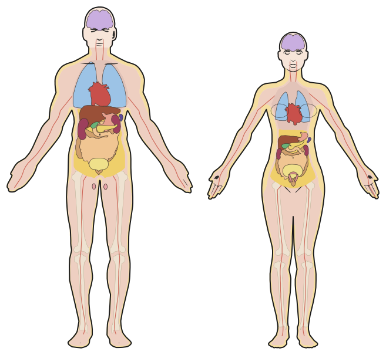
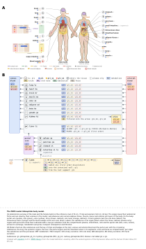
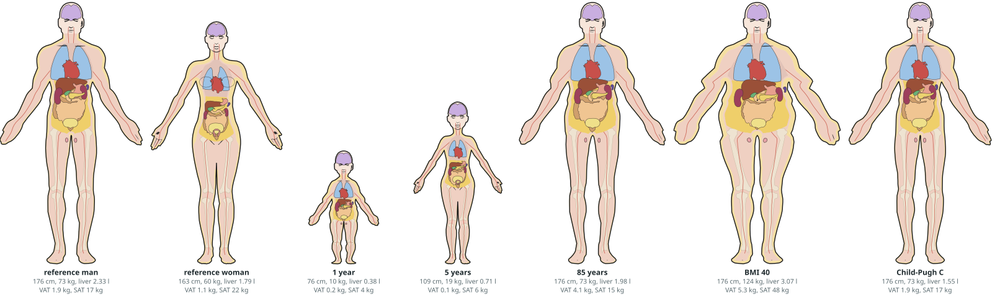

# Figures

The figures of a model are generated from its definition, never drawn by hand: the anatomical figure of the male and the female build, the schematic of the circulation, the one-page figure of a publication which combines both, an interactive page of each for the web, and the bodies of individuals of the library. They read the definition through the same rules as the build (`parts_for`, `luminal_substances`, `bile_substances`, the absorption of the intestine variant), so a figure shows what the model has. Every figure is SVG, pure python and deterministic: the same definition gives the same bytes.

The figures on this page are those of the glimepiride-like model of the [tutorial](tutorial.md), given orally and intravenously; `scripts/visual/docs_figures.py` writes them and `tests/docs/test_docs_figures.py` fails while one is out of date. The docs show the anatomical figure (A) and the schematic (B) as interactive pages only, and every page of the PBPK library which creates a model shows its two figures after the snippet which creates it: the script runs the snippets of the page up to the definition, writes its figures into `img/figures/models/` and the frames which show them into a generated region of the page (`<!-- generated: figures-<page>-<snippet> ... -->`). A frame takes the height its page posts (`docs/javascripts/figures.js`).

| Figure | Function | Written by `create_archive` |
| --- | --- | --- |
| Anatomical figure | `anatomy_figure(definition, path)` | `<sid>_body.svg` (key `<sid>_body_svg`) |
| Bodies without annotations | `anatomy_figure(definition, path, annotations=False)` | no |
| Schematic | `model_figure(definition, path)` | `<sid>.svg` (key `<sid>_svg`) |
| Interactive page | `interactive_figure(definition, path, figure="anatomy" or "schematic")` | no |
| Publication figure | `publication_figure(definition, path, pdf=False)` | no |
| Bodies of individuals | `body_strip(individuals)` of `pkpdsim.pbpk.visual.body` | no |

## The anatomical figure

The man and the woman of the reference individuals of the library stand next to each other, each captioned with its build; the builds share the structure of the definition, so one label serves both. The bodies carry:

- the organs in the forms of the drawing, each sized by its volume in the model, the cube root of its volume over the volume of the reference individual; the space between them is visceral adipose tissue (abdomen) or mediastinum (thorax);
- the layers of the body: the subcutaneous adipose tissue as a band under the skin (its thickness from the subcutaneous depot of the library over the body surface, twice on the trunk), the muscle, the bones of the legs and the arteries;
- the connections of the model: the portal vein into the liver, the bile from the liver over the gallbladder into the duodenum, the ureters to the bladder and out, the feces and the oral route;
- circled icons: a tablet for an oral dose, a syringe for an intravenous dose, a drop for the blood sample at the arm vein.

Every organ has a label with its circled icon, in greys (`palette.ORGAN_GREYS`) so that the colours of a figure are those of the substances and the tissues, and its substances: a filled dot where the substance enters the tissue, a dashed ring where it stays in the plasma. An organ with processes shows its submodel: a row per substance, the compartments plasma, interstitium, cells and the apical side (bile, urine, lumen) as columns, a dot for every species the build has, arrows for the exchange with the plasma, the metabolism with its enzyme, the apical transport with its transporter and the filtration into the urine; the process lines of the schematic follow.

Hovering an organ, a label, a substance or an icon shows its details (the volumes of the organ in the reference man and woman, its UBERON ids, the form of every substance, the processes). It is one HTML file without external scripts, for the docs or GitHub Pages; on github.com itself a README shows the SVG as an image, without scripts, so link the page from there.

<iframe class="pkpd-figure" src="img/figures/anatomy.html" title="The interactive anatomical figure" style="aspect-ratio:1460 / 962" loading="lazy"></iframe>

### The bodies alone

`anatomy_figure(definition, path, annotations=False)` draws the bodies of the builds with their organs and layers alone, without labels, substances, connections, captions and key, on a transparent background, for a slide or a poster. A definition of a laboratory animal gives the animal alone. The drawings are the anatomograms of the Expression Atlas (CC BY 4.0), so a slide credits them next to the figure, see [Anatomy and license](#anatomy-and-license).



## The schematic

The circulation of the model: venous blood on the left and arterial blood on the right, each listing the substances which circulate, the lung between them, the systemic organs, the liver with the portal vein (with its substances) and the portal organs, the intestinal lumen in its segments, urine and feces as compartments with their substances. Every row carries the grey icon of its organ, its substances (filled: enters the tissue; dashed: plasma only) and its processes as badges: `MET` metabolism, `TRA` transport, `CUS` custom reaction, `URI` urine, `SLW` slow pool, `ORL` oral dose, `ABS` absorption, `BIL` bile, `CNV` lumen conversion, `FEC` feces. The legend (the substances with their mechanisms, the routes, the PD components and the key) is a column right of the diagram; the process text wraps at a fixed measure (`MAX_TEXT`) and the width of the figure is that of its content. `model_figure(..., compact=True)` is the panel of a publication figure: the substances and the key in the band above the first row, tighter rows.

Hovering an organ row, a substance chip or a process line shows its details.

<iframe class="pkpd-figure" src="img/figures/schematic.html" title="The interactive schematic" style="aspect-ratio:1410 / 942" loading="lazy"></iframe>

## The publication figure

One A4 page with the anatomical figure (A) and the schematic (B), each in compact form at the width of the page; only the panels have to fit on the page, the legend sits below them. `publication_figure(definition, path)` writes the panels with the legend below (`path`), the panels alone on the A4 page (`<stem>_panels.svg`), the legend as Markdown for the caption of a manuscript (`<stem>_legend.md`) and, with `pdf=True`, the PDF of the panels (the extra `pdf`, `pip install pkpdsim[pdf]`, needs the cairo library of the system).



## Pictograms of impaired organs

`impaired_organ(key, cx, cy, width, height, loss, color, title=None)` of `pkpdsim.pbpk.visual.icons` draws the liver (`li`), a kidney (`ki`) or the heart (`he`) as a pictogram on a card framed in the color of an impairment class: the shape of the anatomy resources in the color of the organ with its details (the lobes and the gallbladder of the liver, the cortex, vessels and ureter of a kidney, the groove of the heart), the lost part `loss` of its area faded (the liver from the right, the kidney and the heart from the top). The overview of [Impairment](impairment.md#impairment) shows them for every class, the figure of [Impairment classes](classes.md) above the scales of the classes.

## Individuals

The body of an individual follows its numbers in the library: the height and weight of its age, the waist of the visceral depot, the subcutaneous and visceral adipose tissue and the volumes of its organs. The drawing changes by stretching: the proportions of the age along the height, the trunk by the waist, the limbs and the face by the body mass index, the pregnant belly as the one local change. `Individual(sex, age=35.0, bw=None, height=None, liver=1.0, pregnant=0.0, label="")` of `pkpdsim.pbpk.visual.body` is the reference individual of the age by default; `liver` is the functional liver of a Child-Pugh class.

```python
from pkpdsim.pbpk import Sex, body_strip
from pkpdsim.pbpk.visual.body import Individual

svg = body_strip(
    [
        Individual(Sex.MALE, label="reference man"),
        Individual(Sex.MALE, bw=40 * 1.76**2, label="BMI 40"),
    ]
)
print(svg[:4])
```

```text
<svg
```



## Anatomy and license

The drawings are the anatomograms of the Expression Atlas of EMBL-EBI, which the Human Protein Atlas uses as well, under CC BY 4.0 (https://github.com/ebi-gene-expression-group/anatomogram). `scripts/visual/anatomy_assets.py` converts them at a pinned commit into one JSON resource per species and sex in `pkpdsim/resources/anatomy/` (the human male and female, the mouse male and female and the rat): the outline, the organs of the library by their `Organ` key with their UBERON ids, further anatomy, the landmarks and the body cavities (`pkpdsim.pbpk.visual.resources`). A figure names the anatomograms, their license and pkpdsim in its legend, never inside the figure; the interactive pages carry the legend below the figure.
